# 📦 Inventory Management System

Aplikasi manajemen inventaris berbasis web yang dibangun dengan **Laravel 13** dan **SQLite**. Sistem ini dirancang untuk mengelola produk, kategori, supplier, serta pergerakan stok (barang masuk & keluar) dengan dukungan manajemen pengguna berbasis peran (Role-Based Access Control).

---

## ✨ Fitur Utama

- **Dashboard** — Ringkasan statistik: total produk, nilai inventaris, stok rendah, total transaksi masuk/keluar
- **Manajemen Produk** — CRUD produk dengan SKU, harga, stok, dan ambang batas stok minimum
- **Manajemen Kategori** — Kategorisasi produk
- **Manajemen Supplier** — Data supplier lengkap dengan relasi many-to-many ke produk
- **Transaksi Stok** — Pencatatan barang masuk (IN) dan keluar (OUT) beserta riwayat mutasi
- **Laporan Inventaris** — Laporan stok secara keseluruhan
- **Manajemen Pengguna** — CRUD user dengan role Admin & Staff (khusus Admin)
- **Autentikasi** — Login/logout dengan middleware role guard

---

## 🛠️ Tech Stack

| Layer       | Teknologi                    |
|-------------|------------------------------|
| Backend     | Laravel 13 (PHP ^8.3)        |
| Database    | SQLite (default) / MySQL     |
| Frontend    | Blade Templates + Vite       |
| Auth        | Laravel Session Auth         |
| Dev Tools   | Laravel Pint, Pail, Tinker   |

---

## 🗂️ Struktur Database

```
users
  ├── id, name, email, password, role (admin|staff)
  └── user_profiles (avatar, phone, etc.)

categories
  └── id, name, description

suppliers
  └── id, name, contact_person, phone, email, address

products
  ├── id, sku, name, price, stock, minimum_stock
  └── category_id → categories

product_suppliers (pivot many-to-many)
  ├── product_id → products
  ├── supplier_id → suppliers
  └── supplier_price

stock_movements
  ├── id, type (IN|OUT), quantity, notes
  ├── product_id → products
  └── user_id → users
```

---

## 🔐 Role & Akses

| Fitur                          | Staff | Admin |
|-------------------------------|:-----:|:-----:|
| Lihat Dashboard                |  ✅   |  ✅   |
| Lihat Produk & Supplier        |  ✅   |  ✅   |
| Input Transaksi (IN/OUT)       |  ✅   |  ✅   |
| Lihat Laporan Inventaris       |  ✅   |  ✅   |
| CRUD Produk                    |  ❌   |  ✅   |
| CRUD Kategori                  |  ❌   |  ✅   |
| CRUD Supplier                  |  ❌   |  ✅   |
| Manajemen User                 |  ❌   |  ✅   |

---

## ⚙️ Persyaratan Sistem

- PHP >= 8.3
- Composer >= 2.x
- Node.js >= 18.x & npm
- SQLite (sudah terintegrasi, tidak perlu instalasi terpisah)

---

## 🚀 Cara Instalasi

### 1. Clone Repository

```bash
git clone https://github.com/<username>/iventory-laravel.git
cd iventory-laravel
```

### 2. Setup Otomatis (Recommended)

```bash
composer run setup
```

Script ini secara otomatis akan:
- Install dependensi PHP & Node.js
- Menyalin `.env.example` ke `.env`
- Generate application key
- Menjalankan migrasi database
- Build asset frontend (Vite)

### 3. Setup Manual (Alternatif)

```bash
# Install dependensi
composer install
npm install

# Konfigurasi environment
cp .env.example .env
php artisan key:generate

# Jalankan migrasi & seeder
php artisan migrate --seed

# Build frontend assets
npm run build
```

---

## ▶️ Menjalankan Aplikasi

```bash
composer run dev
# atau
php artisan serve
```

Akses aplikasi di: **http://localhost:8000**

---

## 🌱 Default Seeder

Setelah menjalankan `php artisan migrate --seed`, akun berikut tersedia:

| Role  | Email               | Password    |
|-------|---------------------|-------------|
| Admin | admin@example.com   | password    |
| Staff | staff@example.com   | password    |

> ⚠️ Ubah password default setelah login pertama kali di lingkungan produksi.

---

## 📁 Struktur Direktori Penting

```
app/
├── Http/
│   ├── Controllers/
│   │   ├── AuthController.php
│   │   ├── DashboardController.php
│   │   ├── ProductController.php
│   │   ├── CategoryController.php
│   │   ├── SupplierController.php
│   │   ├── TransactionController.php
│   │   ├── ReportController.php
│   │   └── UserController.php
│   └── Middleware/
├── Models/
│   ├── User.php
│   ├── Product.php
│   ├── Category.php
│   ├── Supplier.php
│   ├── StockMovement.php
│   └── UserProfile.php
database/
├── migrations/
└── seeders/
resources/
├── views/       # Blade templates
├── css/
└── js/
routes/
└── web.php
```

---

## 🧪 Menjalankan Test

```bash
composer run test
# atau
php artisan test
```

---

## 🔧 Konfigurasi Database (MySQL)

Secara default aplikasi menggunakan **SQLite**. Untuk beralih ke MySQL, ubah konfigurasi berikut di file `.env`:

```env
DB_CONNECTION=mysql
DB_HOST=127.0.0.1
DB_PORT=3306
DB_DATABASE=inventory_db
DB_USERNAME=root
DB_PASSWORD=your_password
```

Kemudian jalankan ulang migrasi:

```bash
php artisan migrate --seed
```

---

## 📸 Dokumentasi Tampilan Sistem & Routes

### 1. Dokumentasi CRUD dan Blade View

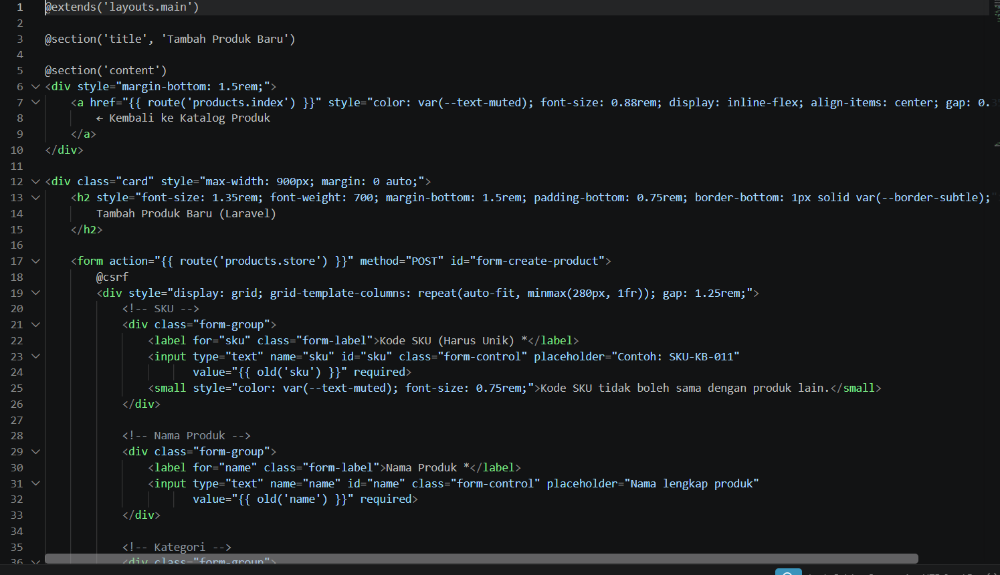

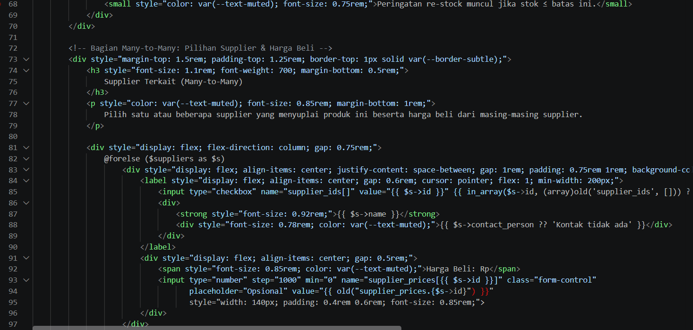

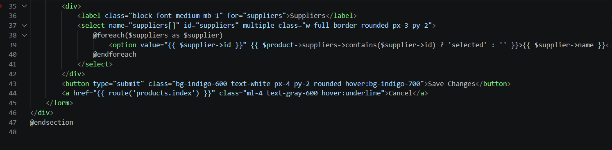

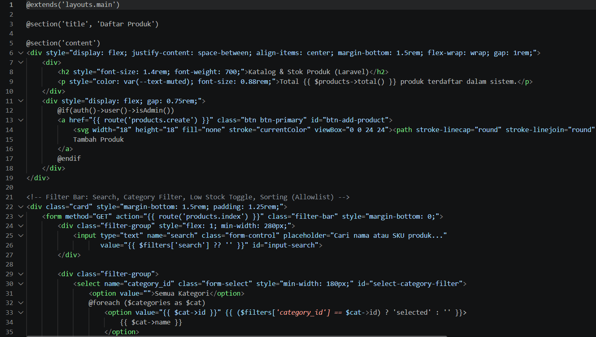

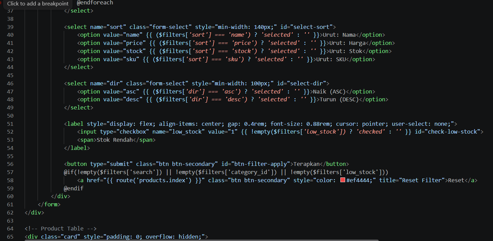

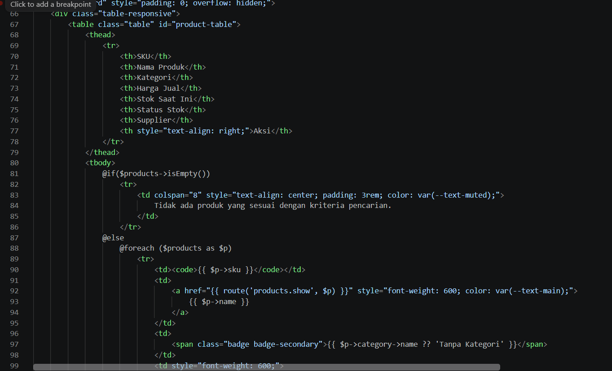

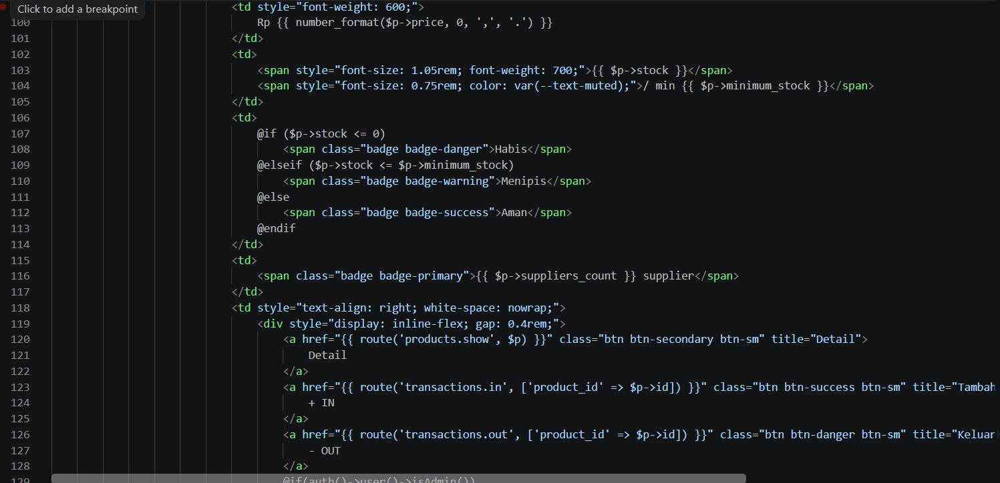

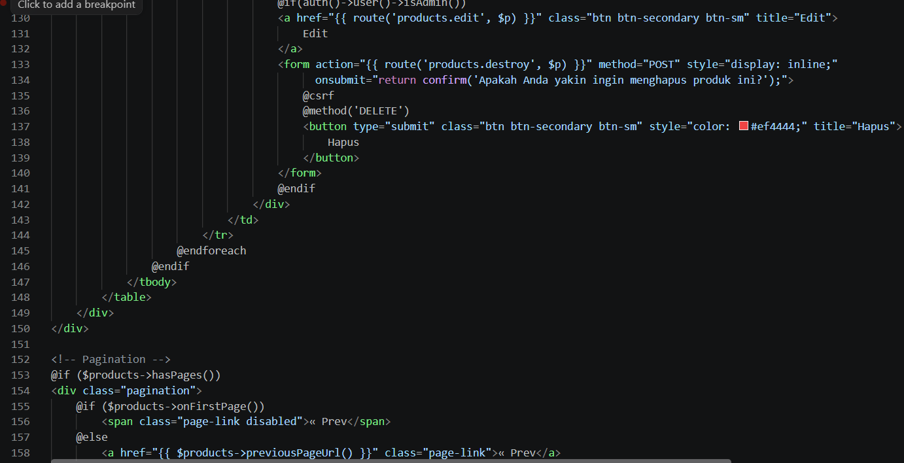

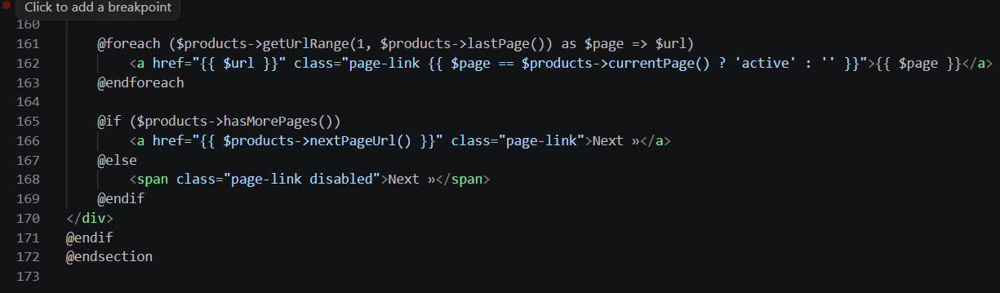

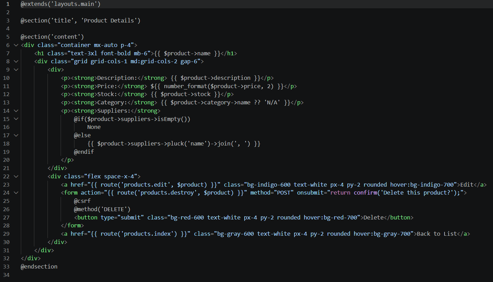

---

### 2. Dokumentasi Routes

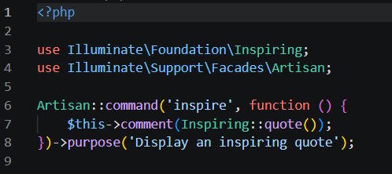

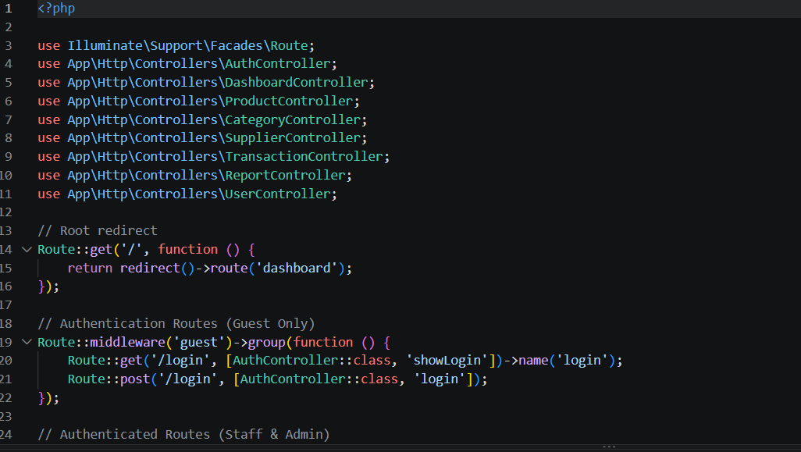

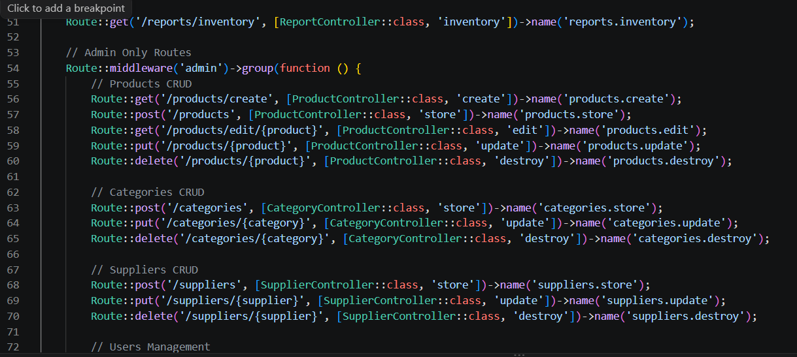

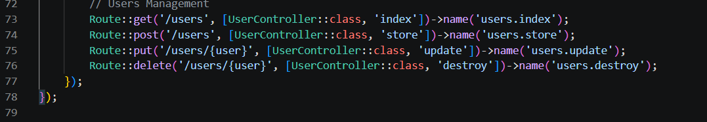

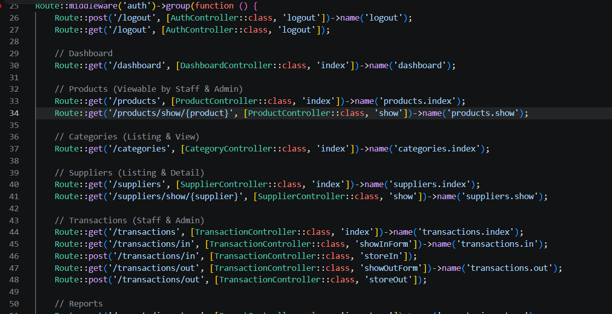

## 📄 Lisensi

Proyek ini dilisensikan di bawah [MIT License](https://opensource.org/licenses/MIT).

